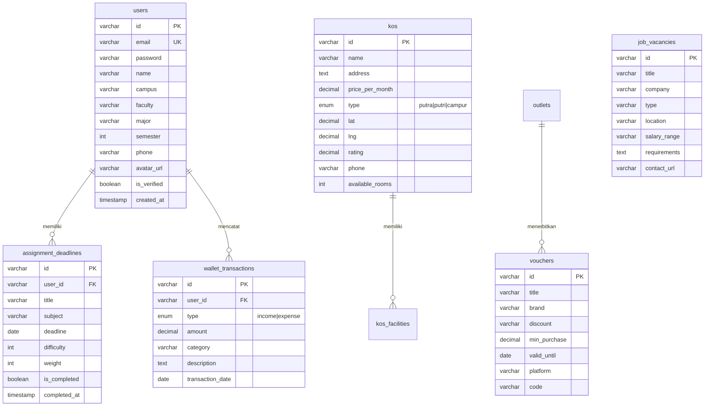

# Sahabat Mahasiswa - Portal Terintegrasi Mahasiswa Indonesia

<p align="center">
  
</p>

<p align="center">
  <strong>Platform All-in-One Kebutuhan Hidup dan Perkuliahan Mahasiswa Indonesia</strong><br />
  Pencarian Kos Kampus • Voucher Kuliner • Lowongan Magang/Part-time • Catatan Keuangan • Manajemen Tugas
</p>

<p align="center">
  
  
  
  
  
  
</p>

---

## Gambaran Umum

Sahabat Mahasiswa adalah portal terintegrasi berbasis web dan mobile-responsive yang diciptakan untuk menyelesaikan persoalan esensial mahasiswa sehari-hari. Mulai dari mencari hunian kos strategis di sekitar kampus, menghemat pengeluaran melalui direktori voucher kuliner, memonitor sirkulasi uang saku bulanan, memanajemen tenggat tugas kuliah, hingga menemukan lowongan kerja paruh waktu dan magang.

Aplikasi dirancang dengan estetika antarmuka modern terinspirasi platform editorial travel/booking premium (seperti Hide.com dan Airbnb) dengan sentuhan identitas khas Universitas Siliwangi (UNSIL) — memadukan palet hijau almamater Emerald Green (`#064e3b`), aksen emas harimau Tiger Amber Gold (`#d97706`), tipografi tegas, serta maskot resmi Maung UNSIL Sahabat Mahasiswa.

---

## Daftar Isi

1. [Fitur Utama](#fitur-utama)
2. [Desain dan Antarmuka](#desain-dan-antarmuka)
3. [Arsitektur dan Tumpukan Teknologi](#arsitektur-dan-tumpukan-teknologi)
4. [Arsitektur Basis Data (MySQL)](#arsitektur-basis-data-mysql)
5. [Prasyarat Sistem](#prasyarat-sistem)
6. [Instalasi dan Konfigurasi](#instalasi-dan-konfigurasi)
7. [Migrasi dan Seed Database](#migrasi-dan-seed-database)
8. [Akun Uji Coba (Demo Credentials)](#akun-uji-coba-demo-credentials)
9. [Menjalankan Aplikasi](#menjalankan-aplikasi)
10. [Dokumentasi REST API](#dokumentasi-rest-api)
11. [Struktur Direktori Proyek](#struktur-direktori-proyek)
12. [Dukungan Desktop Launcher](#dukungan-desktop-launcher)
13. [Standar Kualitas dan Pengujian](#standar-kualitas-dan-pengujian)
14. [Lisensi](#lisensi)

---

## Fitur Utama

### 1. Pencarian Kos Kampus (Kosan Tab)
* **Kategori Horisontal Cerdas**: Filter cepat kategori yang lazim digunakan mahasiswa:
  * Semua Kos
  * Kos Putra
  * Kos Putri
  * Kos Campur
  * Kos Eksklusif
  * Kos Hemat (< Rp 600.000 / bulan)
  * Kontrakan & Rumah (pilihan sewa kelompok/tahunan)
* **Perhitungan Jarak GPS Presisi (Haversine Formula)**:
  * Menghitung jarak lurus kilometer aktual antara lokasi kos dengan titik koordinat kampus secara akurat.
  * Opsi referensi kampus fleksibel: UNSIL Kampus 1 (Mugarsari / Siliwangi) dan UNSIL Kampus 2 (Tamansari).
* **Filter Multi-Kriteria**:
  * Pilihan radius: Semua Jarak, < 500m, < 1 km, < 2 km, atau < 5 km.
  * Filter rentang harga maksimal bulanan.
  * Pencarian kata kunci nama kos, jalan, atau fasilitas.
* **Kartu Kosan Editorial**:
  * Badge harga bulanan dengan opsi format per tahun.
  * Rating bintang dan ulasan penghuni.
  * Indikator sisa kamar kosong real-time.
  * Tombol aksi instan: Hubungi Pengelola via WhatsApp API dan petunjuk rute di Google Maps.
* **Modal Detail Kosan Lengkap (`KosanDetailModal`)**:
  * Menampilkan galeri foto kamar, daftar fasilitas (WiFi, KM Dalam, Kasur, Lemari, Dapur, Parkir), peraturan kos, simulasi biaya sewa, dan bio pemilik.
* **Sistem Favorit**: Bookmark kosan tersimpan secara persisten pada `localStorage`.

### 2. Voucher dan Promo Kuliner (Voucher Tab)
* **Horizontal Icon Rail**:
  * Semua Menu
  * Makanan Berat (Ayam Geprek, Nasi Padang, Warteg, Ricebowl)
  * Kopi & Minuman (Kopi Susu, Boba, Es Teh, Minuman Dingin)
  * Camilan & Roti (Toast, Croissant, Dimsum, Pastry)
  * Fast Food (Burger, Fried Chicken, Pizza)
  * Ayam & Bebek (Spesialis olahan unggas)
  * TikTok GO (Promo eksklusif TikTok Dining)
* **Sorting dan Filter Praktis**:
  * Pengurutan berdasarkan Diskon Terbesar, Harga Termurah, atau Rating Toko.
  * Quick filter platform: Semua, GoFood, GrabFood, ShopeeFood, Dine-in Langsung.
* **Modal Outlet Merchant (`OutletModal`)**:
  * Profil merchant/outlet mitra sekitar kampus, jam buka-tutup operasional, alamat lengkap, pin Google Maps, dan menu terlaris.
* **Klaim Voucher Deterministik (`ClaimVoucherModal`)**:
  * Generator kode serial voucher unik per pengguna untuk ditukarkan langsung di kasir atau aplikasi pesan-antar.
* **Integrasi TikTok GO Dining API (`TikTokConfigModal`)**:
  * Konfigurasi API Client Key & Access Token merchant untuk sinkronisasi promo secara live.

### 3. Lowongan Kerja dan Magang (Kerja Tab)
* **Kategori Profesi Mahasiswa**:
  * IT & Tech (Frontend, Backend, Mobile, WordPress, IT Support)
  * Design & UI/UX (Graphic Designer, Illustrator, Video Editor)
  * Marketing & Sosmed (Content Creator, Social Media Specialist, Admin Live Streaming)
  * FnB & Barista (Barista Coffee Shop, Crew Resto, Kasir)
  * Admin & Data (Data Entry, Staf Administrasi, Pengarsipan)
* **Dual Data Engine**:
  * Mengambil data lowongan lokal dari database MySQL.
  * Integrasi Adzuna Job Search API secara live dengan fallback otomatis.
  * Modal kustomisasi konfigurasi API Adzuna (`AdzunaConfigModal`).
* **Lamar Cepat**:
  * Tombol tautan WhatsApp HRD/Owner, email pengiriman CV, atau portal karir resmi perusahaan.
* **Bookmark Lowongan**: Simpan pekerjaan yang diminati untuk ditinjau nanti.

### 4. Dompet Mahasiswa (Keuangan)
* **Manajemen Mutasi Keuangan**:
  * Pencatatan pemasukan (income) seperti uang bulanan orang tua, beasiswa, freelance, atau gaji part-time.
  * Pencatatan pengeluaran (expense) dengan kategori terarah (Makan, Kos, Fotokopi/Buku, Bensin/Transport, Hiburan, dll.).
* **Kalkulasi dan Statistik Real-Time**:
  * Widget kartu ringkasan: Total Saldo Aktif, Total Pemasukan Bulan Ini, Total Pengeluaran Bulan Ini.
  * Visualisasi persentase pengeluaran berdasarkan kategori.
* **Penyimpanan Database**: Seluruh mutasi uang tersimpan aman dan terisolasi per akun di tabel `wallet_transactions` MySQL.

### 5. Manajemen Tugas Kuliah (Tugas Tab)
* **To-Do List Terstruktur**:
  * Input nama mata kuliah, rincian tugas, tanggal deadline, dan tingkat bobot tugas (Ringan, Sedang, Berat).
* **Indikator Countdown Deadline**:
  * Menghitung sisa hari pengumpulan secara otomatis dengan penanda warna urgensi (merah untuk deadline mendesak).
* **Penyelesaian Cepat**:
  * Toggle centang selesai dengan timestamp penyelesaian yang langsung tersinkron ke tabel `assignment_deadlines` MySQL.

### 6. Profil dan Autentikasi Pengguna
* **Sistem Akun Aman**:
  * Enkripsi kata sandi menggunakan `bcryptjs` (kompatibel format `$2a$` dan `$2y$`).
  * Manajemen sesi NextAuth.js teruji.
* **Verifikasi Email Kampus**:
  * Dukungan deteksi domain email akademik kampus resmi (seperti `@unsil.ac.id`, `@ui.ac.id`, `@itb.ac.id`, dll.) yang memberikan lencana Mahasiswa Terverifikasi.
* **Manajemen Biodata**:
  * Atur Nama, Kampus, Fakultas, Program Studi, Semester berjalan, Nomor WhatsApp, dan Foto Profil.

---

## Desain dan Antarmuka

Platform mengadopsi standar visual kelas atas:
- **Pill Navigation dan Segmented Filters**: Navigasi kategori berbasis ikon horizontal dengan indikator garis aktif melengkung yang mulus (fluid scroll).
- **Sticky Modern Navbar**: Dilengkapi logo maskot Sahabat Mahasiswa, pill selector radius & kampus terintegrasi, search global, toggle dark mode, dan tombol profil/login.
- **Mobile Floating Bottom Nav (`BottomNav.tsx`)**: Dock navigasi melayang berpenampilan iOS/Glassmorphism yang ergonomis pada perangkat ponsel.
- **Dark Mode dan Light Mode Dinamis**: Kontras tinggi, warna teks slate seimbang, dan bebas silau di malam hari.
- **Micro-Interactions**: Transisi halus hover kartu, dialog backdrop blur, dan animasi toast notifikasi.

---

## Arsitektur dan Tumpukan Teknologi

| Komponen | Teknologi | Keterangan |
|---|---|---|
| **Frontend Framework** | **Next.js 16.4.3** | Menggunakan App Router dengan compiler Next-gen **Turbopack** |
| **UI Library** | **React 19.3.0** | Strict mode, bebas issue cascading render hooks |
| **CSS Styling** | **Tailwind CSS v4** | Dikompilasi dengan `@tailwindcss/turbopack` |
| **Icons** | **Lucide React v1.56** | Ikon modern, ringan, dan tree-shaken |
| **Bahasa Pemrograman** | **TypeScript 5.x** | Mode pengetikan ketat (strict mode) |
| **Database Server** | **MySQL 8.0+ / MariaDB** | Berjalan di lingkungan lokal **Laragon** (Port 3306) |
| **Database Driver** | **`mysql2/promise`** | Connection pool singleton berkinerja tinggi |
| **Autentikasi & Keamanan** | **NextAuth.js v4** & **`bcryptjs`** | Salt round 10, perlindungan brute-force |
| **Integrasi Eksternal** | **Adzuna API**, **TikTok API** | REST client dengan mekanisme caching dan fallback |

---

## Arsitektur Basis Data (MySQL)

Seluruh data tersimpan secara persisten pada database MySQL lokal bernama `sahabat_mahasiswa`.



### Compatibility Views
Untuk mendukung kompatibilitas query backward:
* `profiles` $\rightarrow$ `SELECT ... FROM users`
* `tugas` $\rightarrow$ `SELECT ... FROM assignment_deadlines`
* `transaksi` $\rightarrow$ `SELECT ... FROM wallet_transactions`
* `kosan` $\rightarrow$ `SELECT ... FROM kos`

---

## Prasyarat Sistem

Sebelum memulai instalasi, pastikan sistem komputer Anda memiliki:
1. **Node.js**: Versi `20.x` atau `22.x LTS` (disarankan).
2. **NPM**: Versi `10.x` atau lebih baru.
3. **Laragon**: Versi `6.0+` dengan service **MySQL** atau MariaDB aktif pada port `3306`.
4. **Git**: Untuk kloning repositori.

---

## Instalasi dan Konfigurasi

### 1. Klon Repositori
Buka terminal (Git Bash / PowerShell) dan jalankan:
```bash
git clone https://github.com/berkom-1/SAHABAT-MAHASISWA.git
cd SAHABAT-MAHASISWA
```

### 2. Pasang Dependensi
```bash
npm install
```

### 3. Konfigurasi Variabel Lingkungan (`.env`)
Salin berkas template environment:
```bash
cp .env.example .env
```
Sesuaikan isi berkas `.env` dengan kredensial database Laragon Anda:
```env
# Koneksi Database MySQL (Laragon)
DB_HOST=127.0.0.1
DB_PORT=3306
DB_USER=root
DB_PASSWORD=
DB_NAME=sahabat_mahasiswa

# NextAuth Secret
NEXTAUTH_SECRET=sahabat-mahasiswa-secret-fallback-key-2026
NEXTAUTH_URL=http://localhost:3000

# Kunci API Eksternal (Opsional)
GOOGLE_CLIENT_ID=
GOOGLE_CLIENT_SECRET=
ADZUNA_APP_ID=
ADZUNA_APP_KEY=
```

---

## Migrasi dan Seed Database

1. Buka aplikasi **Laragon**, lalu klik tombol **Start All** (pastikan MySQL bertanda centang hijau/berjalan).
2. Jalankan skrip migrasi otomatis:
```bash
node scripts/migrate.mjs
```
Skrip ini akan secara otomatis:
- Membuat database `sahabat_mahasiswa` bila belum ada.
- Membangun seluruh tabel, indeks, dan compatibility views.
- Mengisi data katalog awal kosan, outlet, voucher, dan lowongan kerja.
- Menginisialisasi akun uji coba mahasiswa terverifikasi.

> *Alternatif Manual:* Anda juga dapat mengimpor file `database/schema.sql` via **HeidiSQL** atau **phpMyAdmin** bawaan Laragon.

---

## Akun Uji Coba (Demo Credentials)

Anda dapat langsung masuk ke aplikasi menggunakan akun demo berikut:

| Field | Kredensial Uji Coba |
|---|---|
| **Email** | `mahasiswa@unsil.ac.id` |
| **Password** | `password123` |
| **Nama** | Budi Santoso |
| **Kampus** | Universitas Siliwangi (UNSIL) |
| **Status** | Mahasiswa Terverifikasi Almamater |

*Catatan: Anda juga dapat mendaftarkan akun baru sewaktu-waktu melalui tombol **Masuk / Daftar** di Navbar.*

---

## Menjalankan Aplikasi

### Mode Pengembangan (Development)
Jalankan server pengembangan dengan Next.js Turbopack:
```bash
npm run dev
```
Buka browser dan akses: [**http://localhost:3000**](http://localhost:3000)

### Pemeriksaan Standar Kode (Linting)
Periksa kepatuhan TypeScript dan ESLint:
```bash
npm run lint
```
*(Saat ini terverifikasi: **0 error, 0 warning**)*

### Kompilasi Produksi (Production Build)
Untuk menguji pembuatan bundle produksi:
```bash
npm run build
```
Lalu jalankan server produksi:
```bash
npm run start
```

---

## Dokumentasi REST API

Seluruh endpoint API berada di bawah prefix `/api/*` dan menghasilkan respons berstandar JSON:

### Autentikasi Pengguna
* `POST /api/auth/login`: Verifikasi kredensial email & kata sandi dengan hash `bcrypt`.
* `POST /api/auth/register`: Pendaftaran pengguna baru ke tabel `users`.
* `GET / POST /api/auth/[...nextauth]`: NextAuth session provider.

### Profil Mahasiswa
* `GET /api/profile?email={email}` atau `?id={id}`: Mengambil data profil lengkap pengguna.
* `PUT /api/profile`: Memperbarui biodata, kampus, jurusan, nomor HP, dan token API.

### Kosan Kampus
* `GET /api/kosan`: Mengambil katalog kos. Parameter opsional:
  * `lat`: Koordinat lintang titik acuan.
  * `lng`: Koordinat bujur titik acuan.
  * `radius`: Batas jarak maksimal dalam meter (misal: 1000).
  * `tipe`: `putra`, `putri`, `campur`, atau `kontrakan`.
  * `maxHarga`: Batas tarif sewa bulanan maksimal.
  * `search`: Kata kunci pencarian nama atau area.

### Direktori Voucher
* `GET /api/vouchers`: Mengambil master data voucher diskon kuliner aktif.

### Lowongan Pekerjaan
* `GET /api/jobs`: Mengambil daftar lowongan kerja mahasiswa dari database MySQL.
* `GET /api/jobs/adzuna`: Agregasi lowongan kerja live dari Adzuna Jobs API dengan parameter `what` dan `where`.

### Catatan Keuangan (Dompet)
* `GET /api/transaksi?userId={id}`: Mengambil seluruh riwayat mutasi keuangan akun.
* `POST /api/transaksi`: Mencatat transaksi pemasukan/pengeluaran baru.
* `DELETE /api/transaksi?id={id}`: Menghapus riwayat transaksi.

### Manajemen Tugas Kuliah
* `GET /api/tugas?userId={id}`: Mengambil daftar tugas kuliah berdasarkan urutan tenggat waktu.
* `POST /api/tugas`: Menambahkan agenda tugas baru.
* `PUT /api/tugas`: Mengubah status penyelesaian atau rincian tugas.
* `DELETE /api/tugas?id={id}`: Menghapus entri tugas.

---

## Struktur Direktori Proyek

```
SAHABAT-MAHASISWA/
├── app/
│   ├── api/                      # REST API Route Handlers
│   │   ├── auth/                 # Login, Register, dan NextAuth
│   │   ├── jobs/                 # Lowongan kerja (MySQL & Adzuna)
│   │   ├── kosan/                # Katalog kosan & Haversine formula
│   │   ├── profile/              # Pengelolaan profil mahasiswa
│   │   ├── transaksi/            # Mutasi keuangan dompet
│   │   ├── tugas/                # Manajemen deadline perkuliahan
│   │   └── vouchers/             # Direktori voucher kuliner
│   ├── apple-icon.png            # Icon perangkat Apple (iOS)
│   ├── favicon.ico               # Favicon browser
│   ├── globals.css               # Konfigurasi Tailwind CSS v4 & theme tokens
│   ├── icon.png                  # PWA standard app icon
│   ├── layout.tsx                # Root layout & NextAuth Provider
│   └── page.tsx                  # Halaman utama aplikasi (Tab switcher)
├── components/                   # Komponen Antarmuka Pengguna (UI)
│   ├── AdzunaConfigModal.tsx     # Modal konfigurasi Adzuna Jobs API
│   ├── AuthModal.tsx             # Modal login & registrasi mahasiswa
│   ├── AuthProvider.tsx          # Wrapper NextAuth SessionProvider
│   ├── BottomNav.tsx             # Navigasi mobile melayang (Floating pill dock)
│   ├── ClaimVoucherModal.tsx     # Modal generator kode klaim voucher
│   ├── DompetTab.tsx             # Tab pencatatan keuangan & mutasi
│   ├── KerjaTab.tsx              # Tab direktori lowongan kerja & magang
│   ├── KosanDetailModal.tsx      # Modal galeri foto & spesifikasi kos
│   ├── KosanTab.tsx              # Tab pencarian hunian kos & radius kampus
│   ├── Navbar.tsx                # Navigasi utama, pill filter & profile menu
│   ├── OutletModal.tsx           # Modal profil merchant & menu andalan
│   ├── ProfileModal.tsx          # Modal pengaturan profil & token eksternal
│   ├── TikTokConfigModal.tsx     # Modal konfigurasi TikTok GO Dining API
│   ├── TugasTab.tsx              # Tab to-do list & deadline countdown
│   └── VoucherTab.tsx            # Tab katalog voucher promo kuliner
├── database/
│   └── schema.sql                # Skema DDL tabel, views, dan data seed
├── lib/
│   ├── api-client.ts             # REST API client wrapper
│   ├── auth.ts                   # Opsi autentikasi NextAuth
│   ├── data.ts                   # Data katalog default & merchant outlet
│   ├── db.ts                     # MySQL2 connection pooling singleton
│   ├── launcher.ts               # Handler integrasi desktop & deeplink WhatsApp/Maps
│   └── types.ts                  # Definisi antarmuka TypeScript terpusat
├── public/                       # Aset publik statis
│   ├── logo.png                  # Logo Maskot Maung UNSIL (Transparan)
│   ├── icon.png                  # Web Icon Maskot
│   ├── app-icon-512.png          # PWA Icon 512x512
│   ├── icon-192.png              # PWA Icon 192x192
│   ├── apple-icon.png            # Apple Touch Icon
│   ├── favicon.ico               # Favicon
│   └── manifest.json             # Web App Manifest (PWA)
├── scripts/
│   ├── migrate.mjs               # Skrip inisialisasi & migrasi database otomatis
│   └── test-db.mjs               # Skrip validasi koneksi database
├── .env.example                  # Template variabel lingkungan
├── eslint.config.mjs             # Konfigurasi ESLint 9 (Flat config)
├── LICENSE                       # Berkas Lisensi MIT
├── next.config.ts                # Konfigurasi Next.js (Turbopack, cache, images)
├── package.json                  # Dependensi dan script NPM
└── tsconfig.json                 # Konfigurasi TypeScript compiler
```

---

## Dukungan Desktop Launcher

Aplikasi dilengkapi modul jembatan `lib/launcher.ts` yang mendukung interoperabilitas dengan aplikasi desktop (Electron wrapper) maupun protokol sistem operasi:
- Membuka tautan eksternal WhatsApp chat (`https://wa.me/...`) langsung ke aplikasi WhatsApp Desktop/Web.
- Membuka tautan rute Google Maps langsung ke perutean navigasi browser/aplikasi peta bawaan.
- Mendukung deep-link aplikasi pesan antar online seperti GoJek, Grab, dan Shopee.

---

## Catatan Rilis & Changelog (Changelog)

### [v1.1.0] - Audit Keamanan, Perbaikan Bug & Fitur Chat Kosan Terintegrasi
Pembaruan komprehensif berdasarkan hasil audit keamanan dan kualitas kode (*findbug audit*) serta peningkatan pengalaman pengguna:

#### 🔒 Keamanan & Otentikasi (Security Fixes)
- **Sanitasi Token Akses TikTok (`app/api/profile/route.ts`)**: Mencegah kebocoran token mentah `tiktok_access_token` ke respons profil publik; token kini disanitasi menjadi nilai boolean `tiktok_connected`.
- **Validasi Domain Email Mahasiswa**: Memastikan pendaftaran dan pembaruan email kampus wajib menggunakan akhiran domain universitas (`.ac.id`, `.edu`, `@student.unsil.ac.id`).
- **Hardening NextAuth Credentials Provider (`app/api/auth/[...nextauth]/route.ts`)**: Menghapus celah kredensial fallback/bypass dummy; seluruh login diwajibkan melalui verifikasi hash kata sandi aman (`bcrypt.compare`).
- **Pencegahan IDOR & Data Leak (`app/api/transaksi/route.ts`, `app/api/tugas/route.ts`)**: Mewajibkan parameter `userId` valid yang terikat sesi agar riwayat transaksi dan tugas antarmahasiswa tidak dapat diakses bebas tanpa otorisasi.
- **Resilient Database Handling (`app/api/auth/login`, `register`, `components/AuthModal.tsx`)**: Menangani error `ECONNREFUSED` saat MySQL lokal belum berjalan dengan pesan panduan ramah serta mode demo fallback client-side yang mulus tanpa freeze atau crash.

#### 💬 Fitur Chat WhatsApp Kosan Terintegrasi
- **Template Pesan Dinamis & Otomatis (`components/KosanDetailModal.tsx`, `components/KosanTab.tsx`, `lib/launcher.ts`)**:
  - Tombol chat WhatsApp pengelola kosan menyusun format pesan personal secara otomatis menggunakan identitas nama dan universitas dari profil pengguna yang aktif:
    > *"Halo pengelola [Nama Kosan], saya [Nama] dari universitas [Universitas], saya melihat info kosan ini di aplikasi Sahabat Mahasiswa (jarak: [Jarak] km dari [Titik Acuan]). Apakah saat ini masih ada kamar yang tersedia?"*
  - Menghitung jarak dinamis dari titik acuan lokasi terpilih secara akurat.
- **Peningkatan UX Modal Kosan**: Mengganti dialog bawaan browser `alert()` dengan feedback visual inline (*copy checkmark indicator*) yang aman untuk lingkungan web maupun Android WebView.

#### ⚙️ Konfigurasi & Lingkungan
- **Penyediaan Berkas `.env.example`**: Menyediakan template variabel lingkungan lengkap tanpa mengekspos kredensial rahasia asli (`.env*` tetap terlindungi di `.gitignore`).

---

## Standar Kualitas dan Pengujian

Proyek ini telah melalui proses standarisasi kode yang ketat:
* **ESLint & TypeScript Rules**: Bersih dari error unused variables, undeclared identifiers, dan missing hook dependencies.
* **React 19 Hooks Compliance**: Menghindari pemanggilan `setState` sinkron langsung di dalam `useEffect` dengan memanfaatkan `queueMicrotask` sehingga mencegah error cascading renders (`react-hooks/set-state-in-effect`).
* **Tailwind CSS v4 Canonical Classes**: Mematuhi aturan kelas kanonik seperti `stroke-2`, `max-w-28`, dan `max-w-37.5`.
* **Turbopack Build Verified**: Kompilasi 15 rute statis dan dinamis berhasil 100% tanpa kendala.

---

## Lisensi

Proyek ini didistribusikan di bawah naungan lisensi **MIT License**. Silakan merujuk ke berkas [LICENSE](LICENSE) untuk informasi lebih lanjut.
